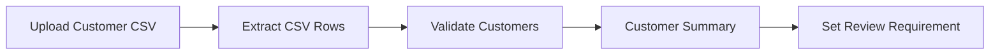

# Customer CSV Review Utility

An n8n workflow that accepts a customer CSV file, validates the extracted rows, generates a customer summary, and flags whether the dataset requires review based on average age.

## Workflow



## What It Does

1. **Upload Customer CSV**
   - Accepts a CSV file through an n8n Form Trigger.

2. **Extract CSV Rows**
   - Uses **Extract From File** to convert the uploaded CSV into separate n8n items.

3. **Validate Customers**
   - Checks every customer row.
   - Stops the workflow if:
     - `name` is missing
     - `email` is missing
     - `age <= 0`

4. **Customer Summary**
   - Counts the customer records.
   - Calculates the average customer age.
   - Collects all customer emails into an array.
   - Returns one summary item.

5. **Set Review Requirement**
   - Adds a `reviewRequired` Boolean.
   - `true` when `averageAge > 40`
   - `false` when `averageAge <= 40`

## Example Input

```csv
name,email,age,country
Anna,ANNA@TEST.COM,29,uk
Mark,MARK@TEST.COM,35,UK
John,john@test.com,42,united kingdom
Sara,SARA@TEST.COM,31,uk
```

## Example Summary Output

```json
{
  "itemCount": 4,
  "averageAge": 34.25,
  "emails": [
    "ANNA@TEST.COM",
    "MARK@TEST.COM",
    "john@test.com",
    "SARA@TEST.COM"
  ],
  "reviewRequired": false
}
```

## Validation

The workflow rejects invalid customer data before producing the summary.

Example invalid cases:

```text
Missing name
Missing email
Age <= 0
```

If invalid data is found, the validation Code node throws an error and stops the workflow.

## AI-Assisted Coding

The **Customer Summary** Code node was drafted using n8n's AI Assistant.

The generated code was reviewed before execution for:

- correct use of `$input.all()`
- correct n8n `.json` data paths
- correct `map()` and `reduce()` logic
- correct calculation of average age
- correct n8n return structure

The code was then executed and its output was checked against the expected result.

## Testing

The workflow was tested with:

- valid CSV data
- invalid customer data
- average age below 40 → `reviewRequired: false`
- average age above 40 → `reviewRequired: true`


